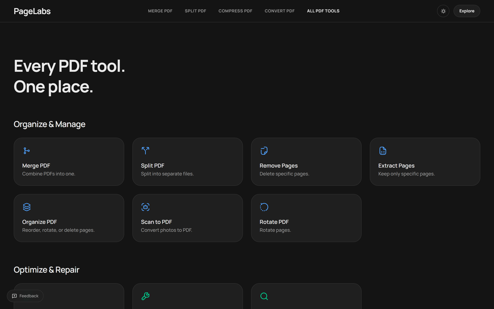
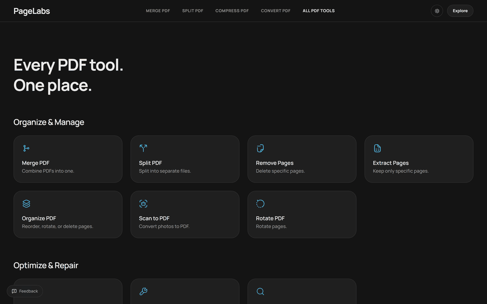
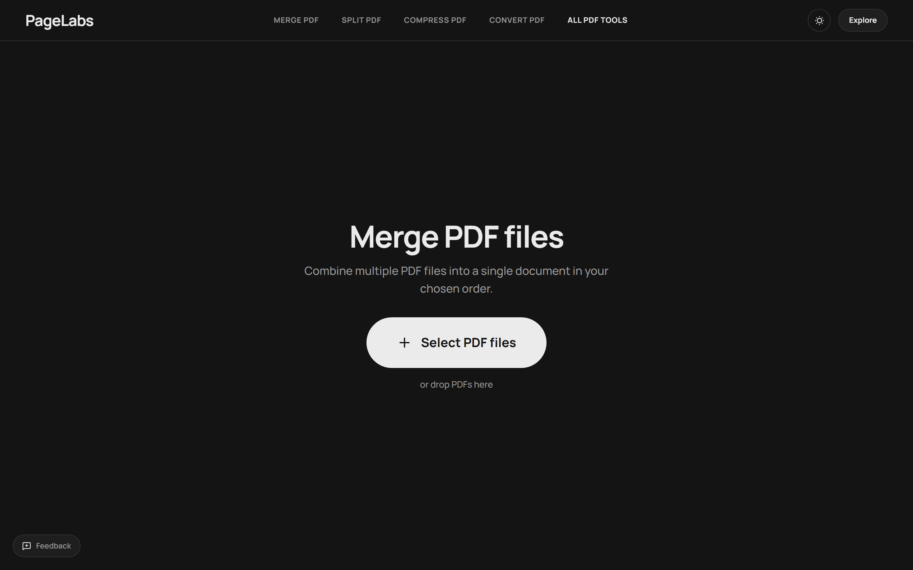
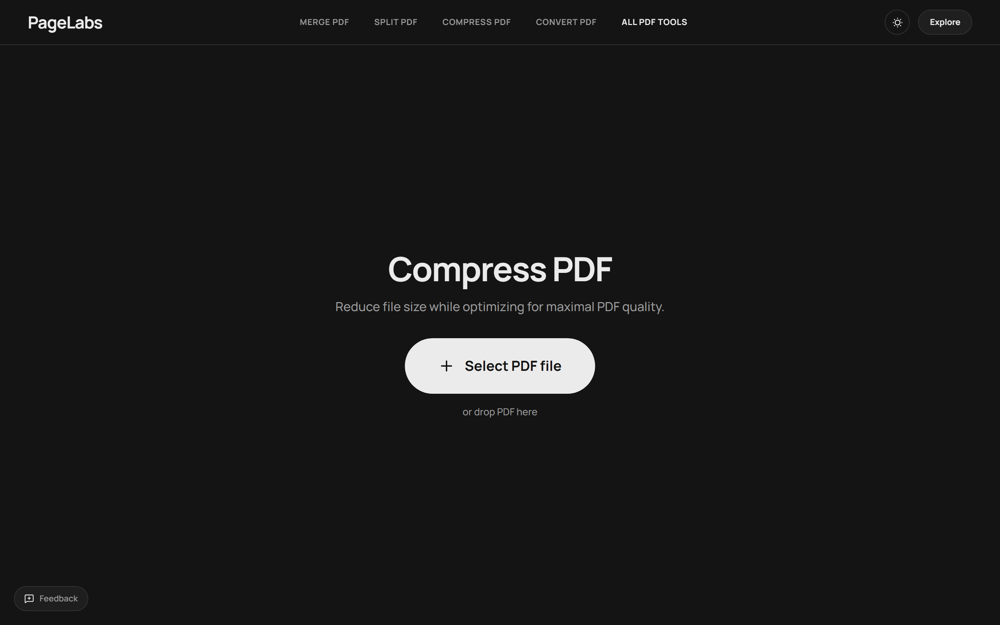
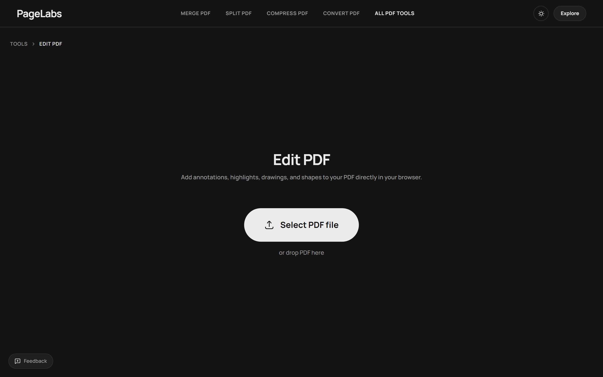
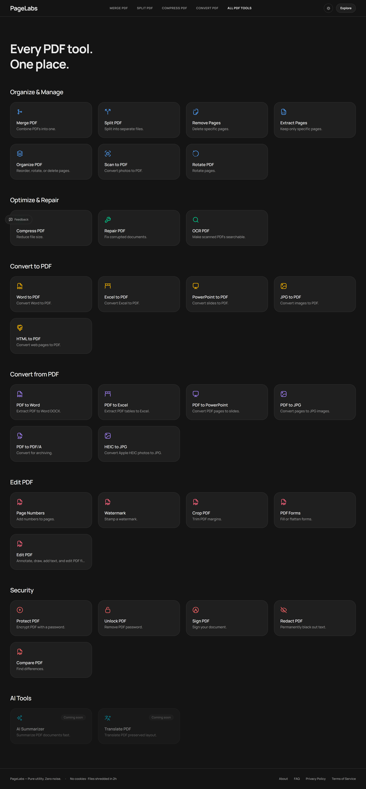

<div align="center">

# PageLabs

**Every PDF tool. One place.**

Clean, privacy-first PDF tools that do the job and get out of the way.
No signup. No cookies. No ads. Your files are shredded after processing.

[**Try it live →**](https://pagelabs.tanbopp.cloud) · [Report a bug](https://github.com/tanbopp/pagelabs-pdf-tools/issues/new?template=bug_report.md) · [Request a feature](https://github.com/tanbopp/pagelabs-pdf-tools/issues/new?template=feature_request.md) · [Discussions](https://github.com/tanbopp/pagelabs-pdf-tools/discussions)

[](https://github.com/tanbopp/pagelabs-pdf-tools/actions/workflows/ci.yml)


</div>



---

## Why PageLabs?

Most online PDF tools are ad farms. They upload your contracts and tax returns to anonymous
servers, nag you to subscribe, watermark the result, and set a dozen tracking cookies along the
way.

PageLabs is the opposite: a flat, fast, open-source suite that does the work and deletes your
file afterwards. If you would rather run it yourself, the whole stack is in this repository and
ships with Docker.

- **Privacy-first by architecture** — ephemeral storage, a scheduled purge, worker temp
  directories removed after every job, and **zero tracking cookies**.
- **31 working tools** — the boring essentials (merge, compress, rotate) and the awkward ones
  (OCR, redact, compare, PDF/A).
- **No watermark, no account, no export paywall.**
- **Self-hostable** — Docker Compose for a single host, or split the web app on Vercel from the
  API and worker containers.
- **Open source, MIT licensed.** Read the code before you trust it with a document.



---

## Tools

31 tools are live today. Two more (AI Summarizer, Translate PDF) are in the registry and marked
coming soon.

### Organize & Manage

| Tool | What it does |
| --- | --- |
| [Merge PDF](https://pagelabs.tanbopp.cloud/tools/merge-pdf) | Combine up to 20 PDFs into one, in any order, with optional bookmarks |
| [Split PDF](https://pagelabs.tanbopp.cloud/tools/split-pdf) | Split by ranges, by interval, or into one file per page |
| [Remove Pages](https://pagelabs.tanbopp.cloud/tools/remove-pages) | Delete unwanted pages from a PDF |
| [Extract Pages](https://pagelabs.tanbopp.cloud/tools/extract-pages) | Keep only the pages you need, or export each one separately |
| [Organize PDF](https://pagelabs.tanbopp.cloud/tools/organize-pdf) | Reorder, rotate and delete pages with drag and drop |
| [Scan to PDF](https://pagelabs.tanbopp.cloud/tools/scan-to-pdf) | Turn photos of documents into a single tidy PDF |
| [Rotate PDF](https://pagelabs.tanbopp.cloud/tools/rotate-pdf) | Rotate every page or just the sideways ones |

### Optimize & Repair

| Tool | What it does |
| --- | --- |
| [Compress PDF](https://pagelabs.tanbopp.cloud/tools/compress-pdf) | Three compression levels, with the resulting size shown before download |
| [Repair PDF](https://pagelabs.tanbopp.cloud/tools/repair-pdf) | Rebuild the structure of a corrupted PDF and recover readable pages |
| [OCR PDF](https://pagelabs.tanbopp.cloud/tools/ocr-pdf) | Add a searchable text layer to scans in 100+ languages |

### Convert to PDF

| Tool | What it does |
| --- | --- |
| [Word to PDF](https://pagelabs.tanbopp.cloud/tools/word-to-pdf) | DOC/DOCX to PDF with fonts and layout preserved |
| [Excel to PDF](https://pagelabs.tanbopp.cloud/tools/excel-to-pdf) | XLS/XLSX to PDF, with fit-to-page for wide sheets |
| [PowerPoint to PDF](https://pagelabs.tanbopp.cloud/tools/powerpoint-to-pdf) | PPT/PPTX to PDF, one slide per page |
| [JPG to PDF](https://pagelabs.tanbopp.cloud/tools/jpg-to-pdf) | JPG, PNG and WebP images into a single PDF |
| [HTML to PDF](https://pagelabs.tanbopp.cloud/tools/html-to-pdf) | Render HTML files to PDF with a real browser engine |

### Convert from PDF

| Tool | What it does |
| --- | --- |
| [PDF to Word](https://pagelabs.tanbopp.cloud/tools/pdf-to-word) | Editable DOCX, with optional OCR for scans |
| [PDF to Excel](https://pagelabs.tanbopp.cloud/tools/pdf-to-excel) | Extract PDF tables into a real spreadsheet |
| [PDF to PowerPoint](https://pagelabs.tanbopp.cloud/tools/pdf-to-powerpoint) | One PDF page per editable slide |
| [PDF to JPG](https://pagelabs.tanbopp.cloud/tools/pdf-to-jpg) | Export pages as JPG or PNG at your chosen DPI |
| [PDF to PDF/A](https://pagelabs.tanbopp.cloud/tools/pdf-to-pdfa) | PDF/A-2b or PDF/A-3b for long-term archiving |
| [HEIC to JPG](https://pagelabs.tanbopp.cloud/tools/heic-to-jpg) | Convert iPhone photos to widely supported JPGs |

### Edit PDF

| Tool | What it does |
| --- | --- |
| [Page Numbers](https://pagelabs.tanbopp.cloud/tools/add-page-numbers) | Position, format, font and starting number for page numbering |
| [Watermark](https://pagelabs.tanbopp.cloud/tools/add-watermark) | Text or image watermark with opacity, rotation and page range |
| [Crop PDF](https://pagelabs.tanbopp.cloud/tools/crop-pdf) | Auto or manual margin trimming |
| [PDF Forms](https://pagelabs.tanbopp.cloud/tools/pdf-forms) | Fill or flatten form fields |
| [Edit PDF](https://pagelabs.tanbopp.cloud/tools/edit-pdf) | Add text, draw, highlight and annotate |

### Security

| Tool | What it does |
| --- | --- |
| [Protect PDF](https://pagelabs.tanbopp.cloud/tools/protect-pdf) | Encrypt with a password and restrict printing or copying |
| [Unlock PDF](https://pagelabs.tanbopp.cloud/tools/unlock-pdf) | Remove a password you already know from your own file |
| [Sign PDF](https://pagelabs.tanbopp.cloud/tools/sign-pdf) | Draw or type a signature and place it on any page |
| [Redact PDF](https://pagelabs.tanbopp.cloud/tools/redact-pdf) | Remove matching text from the file content, not just cover it |
| [Compare PDF](https://pagelabs.tanbopp.cloud/tools/compare-pdf) | Find the differences between two versions of a document |

### Coming soon

| Tool | Status |
| --- | --- |
| AI Summarizer | In the registry, not available yet |
| Translate PDF | In the registry, not available yet |

---

## Screenshots

| Merge PDF | Compress PDF |
| --- | --- |
|  |  |

| Edit PDF | Full tool index |
| --- | --- |
|  |  |

Screenshots are regenerated with `node scripts/capture-docs.mjs` (see [docs/](docs/README.md)).

---

## Key highlights

- **Flat, shadowless design.** No gradients, no elevation, no glass effects. Depth comes from
  1px borders and surface contrast only, with generous 24px radii and Manrope typography.
- **Privacy by default.** Files live in ephemeral storage, generated files are purged on a
  schedule, everything is shredded within two hours, and worker temp directories are deleted
  after each job. PageLabs sets no cookies and uses no analytics.
- **Security hardened.** Content Security Policy, `X-Frame-Options: DENY`,
  `X-Content-Type-Options: nosniff`, magic-byte upload validation (not just the declared MIME
  type), subprocess shell sanitisation, and directory traversal prevention.
- **Built for heavy files.** Out-of-memory handling in the worker, queued jobs with retries, and
  per-IP rate limiting (10 jobs/hour) so one user cannot starve the queue.
- **Accessible.** Full keyboard navigation, screen-reader labels, visible focus rings, and
  respect for `prefers-reduced-motion`.

---

## Tech stack

| Layer | Technology |
| --- | --- |
| Frontend | Next.js 16 (App Router, Turbopack, Server Components), Tailwind CSS v4, Radix UI, dnd-kit, pdf.js, pdf-lib |
| API gateway | Hono on Node.js, Zod validation, SQLite or PostgreSQL, Redis + BullMQ |
| Processing | Python 3.12 with pikepdf, qpdf, Ghostscript, pdfplumber, ocrmypdf, ReportLab, WeasyPrint, Playwright, pdf2docx, openpyxl |
| Storage | MinIO, AWS S3 or Cloudflare R2 |
| Infrastructure | Docker and Docker Compose; the web app also deploys to Vercel |

---

## Project structure

```text
pagelabs-pdf-tools/
├── apps/
│   ├── api/          # Hono API gateway: uploads, jobs, rate limiting, queue
│   ├── web/          # Next.js 16 app: tool UIs, tool registry driven SEO
│   └── worker/       # Python processing recipes + CLI runner
├── packages/
│   └── shared/       # Zod schemas, tool registry, shared types
├── docs/             # Screenshots, social preview, capture script notes
├── prd/              # Product requirement documents for each tool stage
├── docker-compose.yml       # Local dev services (Postgres, Redis, MinIO)
└── docker-compose.prod.yml  # Single-host production deployment
```

The **tool registry** in `packages/shared/src/tools.ts` is the single source of truth: it drives
the homepage grid, the sitemap, per-tool metadata and the FAQ copy.

---

## Getting started

### Prerequisites

- Node.js **20+**
- pnpm **9+**
- Python **3.11+** (only for the worker)
- Docker and Docker Compose (optional, for Redis / MinIO / Postgres)

### 1. Clone and install

```bash
git clone https://github.com/tanbopp/pagelabs-pdf-tools.git
cd pagelabs-pdf-tools

cp .env.example .env
pnpm install
```

### 2. Python worker (optional)

```bash
cd apps/worker
python -m venv venv
# Windows:
.\venv\Scripts\activate
# Linux / macOS:
source venv/bin/activate

pip install -r requirements.txt
cd ../..
```

Some recipes also need system binaries: `qpdf`, `ghostscript`, `libreoffice`, `tesseract-ocr`.
`apps/worker/Dockerfile` lists the exact packages used in production.

### 3. Start infrastructure (recommended)

```bash
docker compose up -d
```

### 4. Run the apps

```bash
pnpm dev
```

- Web app: <http://localhost:3000>
- API gateway: <http://localhost:3001>

---

## Self-hosting

### Option A — Docker Compose on a single host

```bash
cp .env.production.example .env.production
# edit .env.production: secrets, database URL, storage credentials, public URL
docker compose -f docker-compose.prod.yml --env-file .env.production up -d --build
```

### Option B — Split deployment

- **Web (`apps/web`)** → Vercel or Cloudflare Pages. Root directory `apps/web`, build command
  `pnpm build`, and set `NEXT_PUBLIC_API_URL` to your API URL.
- **API (`apps/api`)** → Railway, Render or Fly.io using `apps/api/Dockerfile`.
- **Worker (`apps/worker`)** → Railway or ECS using `apps/worker/Dockerfile`, with CPU/RAM sized
  for your largest documents.
- **Database + storage** → managed PostgreSQL (Neon, Supabase) and S3-compatible object storage
  (Cloudflare R2, MinIO).

---

## Testing

```bash
# TypeScript unit and schema tests
pnpm --filter @pagelabs/shared test
pnpm --filter @pagelabs/api test

# Python worker tests
cd apps/worker && pytest tests/

# Typecheck, lint and full production build
pnpm typecheck
pnpm lint
pnpm build
```

CI runs install, tests, typecheck and build on every push and pull request.

---

## Roadmap

- [x] 31 PDF tools across organize, optimize, convert, edit and security
- [x] Privacy-first processing with scheduled shredding
- [x] Docker Compose self-hosting
- [x] Search-optimised tool pages with structured data
- [ ] **AI Summarizer** — summarize long documents (in the registry, not live)
- [ ] **Translate PDF** — translate while preserving layout (in the registry, not live)
- [ ] **Multi-language UI** — starting with Indonesian
- [ ] Per-tool usage docs and a public API

Have an idea or want to pick one of these up? [Open an issue](https://github.com/tanbopp/pagelabs-pdf-tools/issues/new/choose).

---

## Contributing

Contributions are welcome: bug fixes, new tools, translations, accessibility work and docs.

1. Read [CONTRIBUTING.md](CONTRIBUTING.md).
2. Fork the repository and branch from `main` (`feat/...`, `fix/...`, `docs/...`).
3. Make a focused change and follow [Conventional Commits](https://www.conventionalcommits.org/).
4. Run the tests and `pnpm build`.
5. Open a pull request using the template.

New here? Look for [`good first issue`](https://github.com/tanbopp/pagelabs-pdf-tools/labels/good%20first%20issue)
or [`help wanted`](https://github.com/tanbopp/pagelabs-pdf-tools/labels/help%20wanted).

Please read the [Code of Conduct](CODE_OF_CONDUCT.md) before participating. For security
issues, follow [SECURITY.md](SECURITY.md) — never open a public issue.

---

## License

[MIT](LICENSE) © 2026 PageLabs (tanbopp). Free and open source for everyone.

---

<div align="center">

If PageLabs saved you some time, a ⭐ helps other people find it.

</div>
